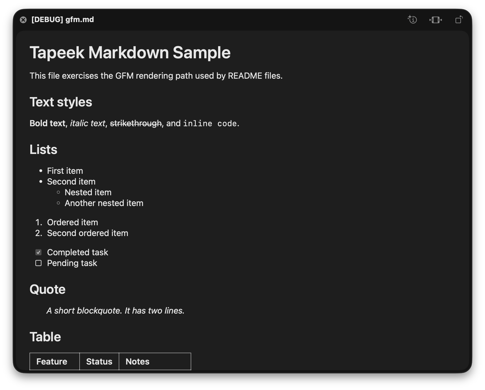
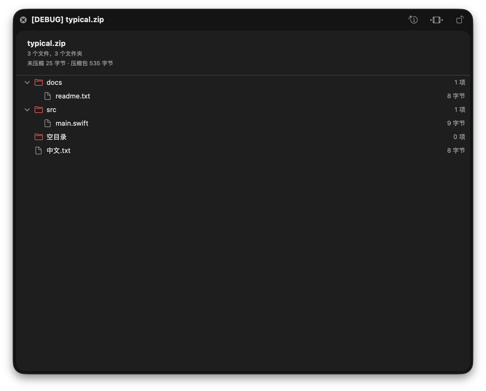

# Tapeek


Tapeek 是一个 macOS Quick Look 预览增强工具：在 Finder 中选中 Markdown 或 ZIP 文件，按空格即可阅读排版后的文档或浏览压缩包目录，不需要打开编辑器或先解压。

官网：<https://tapeek.paymond.me>（源码在 [`website/`](website/)）

当前状态：**MVP 已实现并安装在本机**。Finder 空格和宿主 App 两个按钮已手动确认；VoiceOver/窄窗口留待后续自动化。详细结论见 [FINAL.md](docs/verification/FINAL.md)。

## 能力

- Markdown：GFM 标题、列表、任务列表、表格、代码块、引用、front matter 卡片、图片占位、浅色/深色模式、长文档分块懒加载。
- ZIP：不解压查看目录树、文件大小、摘要、加密标记、空包/损坏/截断状态、中文文件名和 ZIP64。
- 本地处理：不联网、不写用户目录、不产生解压产物。

## 预览





## 下载

Tapeek 0.2.0 适用于 macOS 27、Apple 芯片（arm64）：[DMG](https://github.com/ilderaj/tapeek/releases/download/v0.2.0/Tapeek-0.2.0.dmg) · [ZIP](https://github.com/ilderaj/tapeek/releases/download/v0.2.0/Tapeek-0.2.0.zip) · [SHA256SUMS](https://github.com/ilderaj/tapeek/releases/download/v0.2.0/SHA256SUMS)。

- DMG：打开 `Tapeek-0.2.0.dmg`，把 Tapeek 拖到 Applications，即 `/Applications`。
- ZIP：解压 `Tapeek-0.2.0.zip`，把 `Tapeek.app` 移到 `/Applications`。

Release 包使用 ad-hoc 签名，未经过 Apple 公证。首次打开若被 Gatekeeper 拦截，可右键选择「打开」，或执行：

```sh
xattr -dr com.apple.quarantine /Applications/Tapeek.app
open /Applications/Tapeek.app
```

也可以安装到 `~/Applications`；使用该位置时，把命令中的 `/Applications/Tapeek.app` 改为 `~/Applications/Tapeek.app`。

0.2.0 修复 Markdown 围栏代码块的分块判断，整理 ZIP 解析器以便阅读，并提供可重复执行的 DMG、ZIP 和校验文件打包流程。详见 [发布说明](docs/releases/v0.2.0.md)。

## 打包发布

源码构建需要 Xcode 27 和 `xcodegen`。首次构建需要解析 SwiftPM 依赖。

```sh
./scripts/package-release.sh
gh release create v0.2.0 dist/Tapeek-0.2.0.dmg dist/Tapeek-0.2.0.zip dist/SHA256SUMS --title "Tapeek 0.2.0" --notes-file docs/releases/v0.2.0.md
```

脚本会重新生成工程、构建 Release，并在 `dist/` 生成 `Tapeek-<version>.dmg`、`Tapeek-<version>.zip` 和 `SHA256SUMS`。版本号只在 `project.yml` 中修改（`MARKETING_VERSION` / `CURRENT_PROJECT_VERSION`），格式必须为三段数字，如 `0.2.0`。

同版本的 DMG 或 zip 已存在时，脚本会停止。确认需要替换后，运行 `./scripts/package-release.sh --force`。脚本保留 `dist/` 中的其他文件和其他版本的校验记录；打包失败时清理临时目录。

默认使用 ad-hoc 签名，不公证。可选环境变量：

- `SIGN_IDENTITY`：Developer ID 签名身份；构建仍使用 ad-hoc 签名，随后以 hardened runtime 和时间戳重新签名，先签扩展，再签 App。
- `NOTARY_PROFILE`：`notarytool` 的 keychain profile 名；设置后提交公证并 staple。必须提供非空值，并同时设置非空且不为 `-` 的 `SIGN_IDENTITY`，否则脚本会在构建前报错。

公证模式保留 App 的 stapling 元数据。公证后的 zip 应使用 macOS「归档实用工具」或 `ditto -x -k` 解压；脚本会用 `ditto` 解压并检查签名和公证票据。目前仅验证了默认 ad-hoc 打包流程，Developer ID 签名和公证流程尚未实测。

## 安装与启用

```sh
./scripts/generate.sh
./scripts/build.sh
./scripts/install-local.sh
./scripts/verify-extension.sh
```

然后在「系统设置」→「通用」→「登录项与扩展」→「Quick Look」中启用 Tapeek。回到 Finder，选中 `.md` 或 `.zip`，按空格。

也可以直接用 `qlmanage -p <文件>` 验证同一扩展。

## 测试

```sh
./scripts/run-tests.sh
```

该命令运行 68 项 Core 测试，并要求 `.build/fixtures/` 中的大样本存在。首次运行先生成大样本：

```sh
python3 -I scripts/make-fixtures.py --large-only
```

性能基准：

```sh
swift run -c release --package-path Packages/TapeekCore TapeekBench markdown <path>
swift run -c release --package-path Packages/TapeekCore TapeekBench zip <path>
```

## 卸载

通过 DMG 或 ZIP 安装到 `/Applications` 时，先退出 Tapeek，再把 `/Applications/Tapeek.app` 移到废纸篓。如需先停用扩展，可在「系统设置」→「通用」→「登录项与扩展」→「Quick Look」中关闭 Tapeek。

通过本地开发脚本安装到 `~/Applications` 时，运行：

```sh
./scripts/uninstall-local.sh
```

该脚本只删除 `~/Applications/Tapeek.app` 和 Tapeek 自己的扩展注册，不改动其他扩展的启用状态。

## 轻量性

- Release App 约 2.9 MB，预览扩展约 2.7 MB。
- 500 KB Markdown Core 解析约 0.66 ms；Quick Look 首窗口约 913 ms。
- 20,000 条 ZIP 的 Core 列表 + 树构建约 238–245 ms；首窗口约 0.4 s。
- 超过 2 MiB 的 Markdown 直接拒绝；ZIP 最多显示 20,000 条并提示总数。
- 大文档按标题/空行分块，`LazyVStack` 只渲染可见块。500 KB 文档优化前约 900 MB 内存且 12 秒空白，优化后约 132 MB、1 秒内出现窗口。

## 已知限制

- 同目录图片通常被 Quick Look 沙盒拒绝，显示占位和 alt，正文继续。
- 加密 ZIP 只列目录，不支持密码。
- 不支持分卷 ZIP、RAR、7z、TAR 和自解压 ZIP64。
- 旧式 ZIP 文件名编码只能启发式识别。
- 不支持 Markdown 语法高亮、公式、Mermaid、脚注跳转、文内搜索。

## 文档

| 文档 | 内容 |
| --- | --- |
| [PRD](docs/PRD.md) | 产品目标、范围、验收标准 |
| [实施计划](docs/impl-plan.md) | 架构、命令、技术探针、Core 契约 |
| [功能规格](docs/specs/README.md) | Markdown、ZIP、Quick Look、宿主 App、测试 |
| [执行 tickets](docs/tickets/README.md) | 任务、依赖、范围与验收 |
| [最终验收](docs/verification/FINAL.md) | 证据、性能、限制与结论 |
